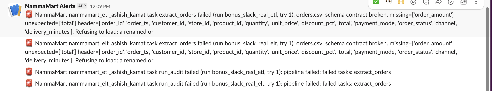

# NammaMart ETL & ELT: submission (Ashish Kamat)

| | |
|---|---|
| DAGs | [`dags/nammamart_etl_ashish_kamat.py`](dags/nammamart_etl_ashish_kamat.py), [`dags/nammamart_elt_ashish_kamat.py`](dags/nammamart_elt_ashish_kamat.py) |
| Helpers | [`include/nammamart_ashish_kamat/`](include/nammamart_ashish_kamat/) (extract, validate, masking, transform, load, reconcile, audit) |
| SQL | [`include/sql/`](include/sql/): `common/` audit DDL, `etl/` ETL DDL + reports, `elt/raw`, `elt/staging`, `elt/dq`, `elt/mart` |
| Warehouse | `include/warehouse_ashish_kamat.duckdb` (git-ignored: `raw_customers` holds unmasked PII) |
| Quarantine | [`include/quarantine/ashish_kamat/`](include/quarantine/ashish_kamat/) |
| Evidence | [`docs/`](docs/): profiling, business questions, data dictionary, runbook, Airflow run histories, experiment outputs, screenshots |
| How to run | [`docs/RUNBOOK.md`](docs/RUNBOOK.md) |

Every number in this document comes from an actual execution: Airflow runs on the local Astro environment (Airflow 3.3.0, Astro Runtime 3.3-2, DuckDB 1.5.6, pandas 2.3.3), or the scripts in `scripts/`. The evidence file is linked next to each claim.

---

## Part 0: Discovery and data profiling

Reproducible profile: `.venv/bin/python scripts/profile_nammamart.py` writes [`docs/profiling/profile_report.md`](docs/profiling/profile_report.md) (per-column nulls, distincts, min/max/mean/median, whitespace, unparseable values), [`column_profile.csv`](docs/profiling/column_profile.csv) and the full row-level [`data_issues_log.csv`](docs/profiling/data_issues_log.csv) (**260 rows**). PII values (name, email, phone, manager name) are never written to the profile; customer issues are identified by `customer_id` only.

### Files as received

`include/data/nammamart/` holds byte-identical copies of the originals; `scripts/experiments.py verify` checks the MD5s.

| File | Rows | Cols | Distinct key | Duplicate-key rows | Exact duplicate rows | Notable nulls / blanks |
|---|---|---|---|---|---|---|
| orders.csv | 2,412 | 13 | 2,400 | 12 | 12 | customer_id 18; order_ts 2 (+4 unparseable); delivery_minutes 164 (156 CANCELLED, 8 DELIVERED) |
| payments.csv | 2,228 | 7 | 2,224 | 4 | 4 | gateway_ref 301 (all Cash on Delivery) |
| customers.csv | 405 | 10 | 400 | 5 | 0 | email `N/A` 4; city 6 |
| products.csv | 152 | 10 | 150 | 2 | 0 | category 3 |
| stores.csv | 15 | 8 | 15 | 0 | 0 | zone 1 |
| orders_2026-10-01_increment.csv | 160 | 13 | 160 | 0 | 0 | none |

Total 5,372 rows. Categorical distributions as received:
- `order_status`: DELIVERED 2,182, CANCELLED 156, RETURNED 69, `Pending??` 3, `delivered` 2.
- `payment_mode` (orders): UPI 1,329, Card 493, Cash on Delivery 326, Wallet 254, `upi` 4, `UPI ` 2, `Cashh` 2, `CARD` 1, `cod` 1.
- `loyalty_tier`: Bronze 185, Silver 133, Gold 54, Platinum 25, `BRONZE` 3, `bronze` 3, `SILVER` 2.
- `zone`: East 4, West 4, North 3, South 3, blank 1.
- `category`: six categories of 22–26 products each, plus 3 blank.

Numeric ranges:
- `quantity`: −3 to 5.
- `discount_pct`: 0–20, plus 120, 150 and 250.
- `delivery_minutes`: 8–1,440 (median 21).
- `mrp`: one value of −203.
- `order_ts`: 2026-09-01 06:30:15 to 2027-01-01 09:00:00.

### Relationships

| Relationship | Orphans |
|---|---|
| orders.customer_id → customers | 0 orphans (18 blank keys) |
| orders.product_id → products | 9 rows (`P9212 P9399 P9455 P9761 P9784 P9816 P9822 P9893 P9989`) |
| orders.store_id → stores | 5 rows (`S00`, `S17`×3, `S99`) |
| payments.order_id → orders | 8 payments (`ORD941071 … ORD997176`, all SUCCESS, ₹4,580.57) |
| increment → masters | 0 orphans |

Other relationship findings:
- 27 DELIVERED orders have **no payment**.
- All 156 CANCELLED orders have no payment (expected).
- All 68 REFUNDED payments belong to RETURNED orders.

The increment file holds **150 new orders** (`ORD002401–ORD002550`, all dated 2026-10-01). It also holds **10 corrections**: `ORD000017, 271, 332, 337, 584, 708, 822, 1025, 1067, 1990` change from DELIVERED to RETURNED, and only `order_status` changes. Profiling found **no defects in the increment file**.

### Data Issues Log (condensed; the 260 row-level entries are in [`data_issues_log.csv`](docs/profiling/data_issues_log.csv))

Every issue below is CONFIRMED from the data. Severity is the rule I applied in both pipelines.

| File | Row key (examples) | Column | Problem | Dimension | Proposed rule | Severity | Rows |
|---|---|---|---|---|---|---|---|
| orders.csv | ORD002255, ORD000701 … | customer_id | blank customer_id | Completeness | customer_id not null | Critical | 18 |
| orders.csv | ORD002103, ORD002305, ORD002004 … | order_amount | ≠ qty × price × (1 − disc/100) (×10 errors, half/double amounts, discount > 100) | Accuracy | formula ± ₹0.01 | Critical | 18 |
| orders.csv | ORD000539, ORD000783 … | order_id | exact duplicate rows | Uniqueness | keep first copy, quarantine extra | Critical | 12 |
| orders.csv | ORD000469, ORD000462 … | quantity | 0 or negative (−3…0), mostly with status DELIVERED | Accuracy | quantity > 0 | Critical | 10 |
| orders.csv | ORD000986, ORD001058 … | product_id | P9xxx not in product master | Consistency | FK to products | Critical | 9 |
| orders.csv | ORD001554, ORD001800 … | delivery_minutes | DELIVERED without delivery time | Completeness | required when DELIVERED | Critical | 8 |
| orders.csv | ORD002119, ORD001693 … | order_ts | 2026-10-21, 2026-11-02, 2027-01-01 (future) | Timeliness | ≤ batch cut-off | Critical | 7 |
| orders.csv | ORD000455, ORD001037 … | delivery_minutes | 480 / 900 / 1,440 (hours, not minutes) | Accuracy | < 120 | Critical | 6 |
| orders.csv | ORD000403, ORD001610 … | order_ts | `N/A`, blank, `2026-13-05`, `31/09/2026` | Validity | parses as timestamp | Critical | 6 |
| orders.csv | ORD001799, ORD001046 … | store_id | S00/S17/S99 not in store master | Consistency | FK to stores | Critical | 5 |
| orders.csv | ORD002103, ORD001468, ORD001237 | discount_pct | 250, 120, 150 | Validity | 0–100 | Critical | 3 |
| orders.csv | ORD000500, ORD001970, ORD001637 | order_status | `Pending??` | Validity | allowed list | Critical | 3 |
| orders.csv | ORD001812, ORD001414 | payment_mode | `Cashh` (cannot be mapped safely) | Validity | allowed list after mapping | Critical | 2 |
| orders.csv | ORD000159, ORD002356 … | payment_mode | `upi`, `UPI `, `CARD`, `cod` | Consistency | trim + map synonyms | Warning | 8 |
| orders.csv | ORD001066, ORD000153 | order_status | `delivered` | Consistency | upper-case | Warning | 2 |
| orders+payments | ORD001113, ORD000737 … | order_id | DELIVERED with no payment | Consistency | reconcile | Warning (reconciliation) | 27 |
| payments.csv | PAY0001568, PAY0000354 … | amount_paid | SUCCESS amount ≠ order_amount (−₹10…−₹100, one negative) | Consistency | equal ± ₹0.01 | Critical | 14 |
| payments.csv | PAY0000944, PAY0002175 … | amount_paid | SUCCESS amount ≤ 0 | Accuracy | > 0 | Critical | 10 |
| payments.csv | PAY0002217–PAY0002224 | order_id | orphan payment | Consistency | FK to orders | Critical | 8 |
| payments.csv | PAY0000396, PAY0000127 … | payment_ts | future (2026-10-21 … 2027-01-01) | Timeliness | ≤ cut-off | Critical | 7 |
| payments.csv | PAY0000509, PAY0001651, PAY0002000, PAY0000755 | payment_id | exact duplicate rows | Uniqueness | keep first, quarantine extra | Critical | 4 |
| payments.csv | PAY0000522, PAY0000044 | payment_mode | `Cashh` | Validity | allowed list | Critical | 2 |
| payments.csv | PAY0002188 … | payment_mode | `upi`, `UPI `, `cod`, `CARD` | Consistency | map synonyms | Warning | 8 |
| payments.csv | 301 rows | gateway_ref | blank, all Cash on Delivery | Completeness | required for non-COD only | Warning (0 failures under that rule) | 301 |
| customers.csv | C00036, C00103, C00226, C00252, C00313 | customer_id | duplicate IDs with different phone/area/pincode | Uniqueness | keep first file occurrence | Critical | 5 |
| customers.csv | C00400, C00398, C00038 | signup_date | 2027-01-05, 2026-11-12, 2026-12-20 | Timeliness | ≤ cut-off (attribute nulled) | Critical | 3 |
| customers.csv | C00337, C00307 … | email | `N/A` (4), missing `@` (5), missing TLD (3) | Validity | name@domain.tld | Warning | 12 |
| customers.csv | C00151, C00240 … | phone | 7–9 digits | Validity | 10 digits, starts 6–9 | Warning | 7 |
| customers.csv | C00132, C00395 … | pincode | `5600XX`, `000000` | Validity | `56xxxx` | Warning | 5 |
| customers.csv | C00355, C00394 … | city | blank | Completeness | flag | Warning | 6 |
| customers.csv | C00199, C00032 … | loyalty_tier | `SILVER`, `bronze`, `BRONZE` | Consistency | title-case | Warning | 8 |
| customers.csv | area Hebbal / Indiranagar / JP Nagar | pincode | one area, several pincodes | Consistency | 1:1 area-pincode | Warning (profiling only) | 3 |
| products.csv | P0019, P0073, P0074, P0117 | cost_price | cost = 1.2 × mrp | Accuracy | cost ≤ mrp (cost nulled) | Critical | 4 |
| products.csv | P0051, P0060, P0068 | category | blank | Completeness | not null (`Unknown`) | Critical | 3 |
| products.csv | P0030, P0140 | product_id | duplicate with `(old)` superseded row | Uniqueness | keep current row | Critical | 2 |
| products.csv | P0109 | mrp | −203 (sign flip; orders sell at 203) | Accuracy | mrp > 0 (mrp nulled) | Critical | 1 |
| stores.csv | S07 | zone | blank | Completeness | allowed zone (`Unknown`) | Critical | 1 |
| stores.csv | S12 | capacity_orders_per_day | 0 | Accuracy | > 0 (nulled) | Critical | 1 |
| stores.csv | S00, S17, S99 | store_id | stores used by orders but missing from master | Consistency | master must be complete | Critical | 1 |

**Assumptions** (not provable from the data alone, so flagged as such):
- Timestamps are IST wall-clock.
- `unit_price` normally equals the product `mrp`. This holds for 99.5% of order rows; the exceptions are P0109 (sign flip) and the unknown P9xxx products.
- The `(old)` product rows are superseded catalogue entries.

### Questions for the client before production

1. **Negative quantities and `RETURNED`:** ten orders have quantity ≤ 0, nine of them with status DELIVERED, and payments carry the same negative amounts. Are these returns booked as negative orders (so they should net against revenue), or data-entry errors? I treat them as errors and quarantine them; returns should arrive as status RETURNED.
2. **Finance's revenue view for late corrections:** when an order delivered in September is returned on 1 Oct, should the September report be restated, or should the reversal be booked in October (as-originally-reported plus an October adjustment)? This decides whether finance reads the restated or the original snapshot (see E9).
3. **Master-data ownership and gaps:** who owns the store and product masters? Orders reference stores S00/S17/S99 and products P9xxx that do not exist. Store S07 has no zone and S12 has capacity 0. Should unknown keys block an order (my default), or should orders load against an "Unknown" member while the master is fixed? Also, can we get a stable source `updated_at` so duplicate customers can be resolved by recency instead of file order?

---

## Business rules and design decisions (both pipelines implement the same rules)

| Topic | Decision |
|---|---|
| Severity | **Critical** rows are quarantined and never reach finance tables. **Warning** rows load, and the warning is recorded on the row (`dq_warnings`) and in `dq_results`. |
| Dimension defects | Identity defects (null or duplicate key) exclude the row. Attribute defects (negative mrp, cost > mrp, blank category or zone, capacity 0, future signup) are `FAILED_ATTRIBUTE`: the row goes to quarantine for the data owner, and the dimension keeps the member with that attribute set to NULL / `Unknown`. A master-data defect never silently drops a real order, and an impossible value never reaches a report. |
| Duplicates | Orders and payments: keep the first exact copy, quarantine the extras; conflicting copies are named column by column. Customers: first file occurrence. Products: the current row beats the `(old)` row. |
| Standardisation | trim; `order_status` upper-case; `loyalty_tier` and `zone` title-case; payment-mode synonyms `upi`/`UPI ` → UPI, `CARD` → Card, `cod` → Cash on Delivery. `Cashh` is **not** guessed. |
| Revenue | `net_revenue = order_amount` for DELIVERED only (already after discount); CANCELLED and RETURNED give 0. |
| Margin | `gross_margin = net_revenue − quantity × cost_price` for DELIVERED. It is NULL when the product cost failed a check (57 delivered September orders) and is reported as `orders_without_cost`. |
| Rounding | Exact decimal arithmetic (Python `Decimal` in ETL, DuckDB `DECIMAL` in ELT), half away from zero to 2 dp, stored as `DECIMAL(12,2)`. |
| Timeliness cut-off | The September files are consumed by the 2026-10-01 09:00 IST run (`as_of` param, pinned so replays give the same answer). The increment `orders_YYYY-MM-DD_increment.csv` uses D+1 09:00. Future = after the cut-off. Stale = latest order more than 24 h before the cut-off. |
| Increment | Upsert by `order_id`. A newer batch wins; an older batch never overwrites a newer one. If the newest version of an order fails a critical check, the stale valid version is removed from the fact (logged in `etl_fact_orders_removed`). |
| Reconciliation | One row per mismatch: MISSING_PAYMENT, PAYMENT_FAILED, NO_SUCCESS_PAYMENT, DUPLICATE_PAYMENT, AMOUNT_MISMATCH, PAYMENT_MODE_MISMATCH, PAYMENT_ON_CANCELLED_ORDER, RETURNED_NOT_REFUNDED (order side); DUPLICATE_PAYMENT_RECORD, UNUSABLE_PAYMENT_RECORD, ORPHAN_PAYMENT, PAYMENT_FOR_REJECTED_ORDER (payment side). CANCELLED orders without payment are not mismatches. `actual_amount` counts only money captured (SUCCESS). |
| PII | name → `T*** U***`, email → `te***@example.com`, phone → `90******12`. A malformed value becomes NULL rather than being partially masked. `manager_name` is not published. |

---

## Part A: ETL pipeline (`nammamart_etl_ashish_kamat`)

```
start_run → extract_{orders,payments,customers,products,stores} (parallel) + extract_order_increment
          → validate_{customers,products,stores} (parallel) → validate_orders → validate_payments
          → quarantine_failed_rows → transform → load_warehouse → reconcile_payments → build_reports
          → run_audit (trigger_rule=all_done)
```

- **Extract:** each file is read as text and its header is checked against the column contract (a missing, renamed or extra column fails loudly). The task records rows, MD5 and `run_id`. Data moves between tasks as run-scoped work files; XCom carries metadata only. Work files are deleted after a successful run because they contain raw PII.
- **Validate:** [`validate.py`](include/nammamart_ashish_kamat/validate.py) applies 71 checks across the 6 dimensions (70 original, plus `orders_unit_price_gross_outlier` added after experiment 8b). Each row gets a status (`PASSED / WARNING / FAILED / FAILED_ATTRIBUTE`), `failed_checks` and an actionable `failure_reason` (e.g. `orders_quantity_positive: quantity -3 <= 0`).
- **Quarantine:** each file's failures go to `include/quarantine/ashish_kamat/<file>_failed_<run_id>.csv`. The file keeps the original values, `source_file`, `source_row_num`, `failed_checks` and `failure_reason`, with PII columns masked. Example: [`orders_failed_scheduled__2026-10-17T03_30_00_00_00.csv`](include/quarantine/ashish_kamat/).
- **Transform:** [`transform.py`](include/nammamart_ashish_kamat/transform.py) standardises, dedupes, masks, conforms and derives `order_date`, `net_revenue`, `cost_amount`, `gross_margin` and `within_15_min`.
- **Load (idempotent):** [`etl_load.py`](include/nammamart_ashish_kamat/etl_load.py) writes the star schema `etl_fact_orders` plus `etl_dim_customer/product/store`, with PKs and CHECK constraints. Dimensions are replaced inside one transaction. The fact is upserted by `order_id` and only rewritten when the incoming batch is the same or newer *and* something changed. Counts go to `etl_load_log`.
- **Reconcile:** writes `etl_payment_reconciliation`.
- **Report:** builds `etl_daily_zone_revenue`, `etl_category_margin`, `etl_delivery_sla`, `etl_payment_mode_revenue`, `etl_top_customers` and `etl_rejected_rows`, and prints them in the task log.

Happy-path result, from the scheduled run `scheduled__2026-10-17T03:30:00+00:00`:
- **Extracted:** 5,212 rows.
- **Validated:** orders 2,298 PASSED, 10 WARNING, 104 FAILED. Payments 2,177 / 8 / 43. Customers 359 / 38 / 5 FAILED / 3 FAILED_ATTRIBUTE. Products 142 PASSED / 2 FAILED (superseded `(old)` duplicates) / 8 FAILED_ATTRIBUTE. Stores 13 PASSED / 2 FAILED_ATTRIBUTE.
- **Quarantined:** 167 rows.
- **Loaded:** 2,308 fact rows and 400/150/15 dimension rows.
- **Reconciliation:** 184 mismatch rows.

## Part B: ELT pipeline (`nammamart_elt_ashish_kamat`)

```
start_run → extract_* (parallel header/contract checks) → load_raw_* (one task per file) + load_raw_order_increment
          → stg_customers, stg_products, stg_stores → stg_orders (versions + MERGE) → stg_payments → record_dq_results
          → int_fact_orders → mart_daily_store_kpis, mart_category_margin, mart_delivery_sla, mart_top_customers,
            mart_payment_reconciliation → mart_payment_mode_revenue; mart_rejected_rows → report → run_audit (all_done)
```

- **Raw:** `raw_orders/payments/customers/products/stores` are loaded by DuckDB `read_csv(all_varchar, nullstr=<never>)` with `INSERT … BY NAME` ([`load_raw.sql`](include/sql/elt/raw/load_raw.sql)). Every value is byte-identical to the CSV, including `''`, `'UPI '` and `'N/A'` (test `test_elt_raw_is_exact_copy`). Each row also carries `_row_num`, `_source_file`, `_loaded_at`, `_run_id` and `_file_md5`. Raw is append-only; a retry deletes only its own `run_id` rows first.
- **Staging (SQL only, [`include/sql/elt/staging/`](include/sql/elt/staging/)):** the same 71 rules as ETL, written as one `SELECT` per check into `stg_dq_row_checks`, which feeds `dq_status`, `failed_checks` and `failure_reason`. `stg_orders_versions` keeps every row of every order file; `stg_orders` is seeded from `orders.csv`. **[`stg_orders_merge.sql`](include/sql/elt/staging/stg_orders_merge.sql)** then runs `MERGE INTO stg_orders … ON order_id` for each increment file in date order, logging inserted / updated / status_changed / skipped_older to `elt_merge_log`. Staging is rebuilt deterministically from raw history on every run, so it is idempotent and replays corrections.
- **Marts (SQL only, [`include/sql/elt/mart/`](include/sql/elt/mart/)):** `int_fact_orders` contains PASSED/WARNING current versions only. The five required marts are built from it, plus `mart_payment_mode_revenue` (Q4) and `mart_rejected_rows` (Q6).

### ETL vs ELT totals: they match

[`scripts/compare_etl_elt.py`](scripts/compare_etl_elt.py) compares the six answers and the fact row by row. The tables show the production warehouse after the scheduled run, the rerun and the increment.

| Check | ETL | ELT |
|---|---|---|
| September delivered orders / net revenue / gross margin (before increment) | 2,086 / ₹1,134,962.80 / ₹266,808.95 | identical |
| September after increment (10 DELIVERED → RETURNED) | 2,076 / ₹1,130,769.10 / ₹265,448.45 | identical |
| Fact rows (order_id, status, revenue, margin, SLA flag) | 2,458 | 2,458, identical rows |
| Q1–Q6 result sets | | identical ([`docs/business_questions.md`](docs/business_questions.md)) |
| `dq_results` | after exp03: 95 (file, check) pairs, 0 count differences | final runs: all base-file checks identical. 26 differences are increment-file checks, which ELT replays from raw while the final ETL run (no `apply_increment`) did not read that file |

No business rule was bent to force the match. Both pipelines implement the same documented rules independently: pandas and `Decimal` in ETL, SQL and `DECIMAL` in ELT.

There is one legitimate behavioural difference:
- **ETL** loads the increment only on runs with `apply_increment=true`. It then *keeps* the corrected state, because an older batch can never overwrite a newer one.
- **ELT** lands the file in raw once, then replays it from raw history on every later run.

### Business questions: one query each, both pipelines

Full SQL and results for both pipelines: [`docs/business_questions.md`](docs/business_questions.md); CSVs in [`docs/evidence/business_questions/`](docs/evidence/business_questions/). Headline answers (current state, after the increment):

| # | Query (ETL table / ELT mart) | Answer |
|---|---|---|
| 1 | `SELECT order_date, zone, store_id, delivered_orders, net_revenue FROM etl_daily_zone_revenue / mart_daily_store_kpis` | 460 date×store rows. September by zone: West ₹292,128.35, East ₹289,906.25, South ₹240,367.80, North ₹225,641.10, `Unknown` ₹82,725.60 (store S07, whose zone is blank in the master) |
| 2 | `SELECT * FROM etl_category_margin / mart_category_margin` | Staples ₹287,601.45 revenue, ₹67,143.14 margin (25.0%) … Fruits & Vegetables ₹99,566.20 (23.7%). 57 delivered orders have unknown cost (cost > mrp products) |
| 3 | `SELECT * FROM etl_delivery_sla / mart_delivery_sla` | Average 20.5–22.5 min per store. Only 21.6% (S06) to 35.4% (S08) of deliveries are within 15 minutes |
| 4 | `SELECT * FROM etl_payment_mode_revenue / mart_payment_mode_revenue` | UPI ₹638,752.15, Card ₹251,882.30, COD ₹181,668.40, Wallet ₹138,118.45. **₹217,123.45 does not reconcile** across 344 mismatch rows. Of that, MISSING_PAYMENT is ₹96,316.55 (177 rows: 27 September and 150 new 1-Oct orders without a payment file yet), PAYMENT_FOR_REJECTED_ORDER ₹84,219.88, PAYMENT_FAILED ₹25,722.25, RETURNED_NOT_REFUNDED ₹4,193.70, ORPHAN ₹4,580.57, DUPLICATE_RECORD ₹1,330.50 and AMOUNT_MISMATCH ₹760.00 |
| 5 | `SELECT * FROM etl_top_customers / mart_top_customers` | #1 C00136 `S*** B***`, `sa***@example.com`, `96******88`, Bronze, ₹8,738.10 … #10 C00209 (Platinum) ₹6,519.40 |
| 6 | `SELECT source_file, check_name, rows_rejected FROM etl_rejected_rows / mart_rejected_rows` | orders.csv 104 rows (formula 18, null customer 18, duplicates 12, quantity 10, …); payments.csv 43; customers.csv 8; products.csv 10; stores.csv 2 |

---

## Part C: Scheduling

Both DAGs use `schedule="0 9 * * 1-6"` with `start_date=pendulum.datetime(2026, 10, 1, tz="Asia/Kolkata")`. Other settings:
- `catchup=False` and `max_active_runs=1` (DuckDB allows one writer).
- `dagrun_timeout=60 min`.
- `default_args`: `retries=2`, `retry_delay=1 min`, `execution_timeout=15 min`, and an `on_failure_callback` alert.

DAG tests run inside the Airflow image ([`tests/dags/test_nammamart_dags.py`](tests/dags/test_nammamart_dags.py), 19 passed) and assert:
- the cron expression and the `Asia/Kolkata` timetable;
- that the run after Sat 17 Oct 09:00 IST is **Mon 19 Oct 03:30 UTC** (Sunday skipped);
- the retry settings;
- `all_done` on the audit task;
- the dependency structure.

1. **Cron expression:** `0 9 * * 1-6` (minute 0, hour 9, Monday–Saturday), interpreted in the DAG timezone `Asia/Kolkata`.
2. **What the UI shows in UTC:** **03:30 UTC** (IST = UTC+05:30). The first real scheduled run appears in the metadata DB as `scheduled__2026-10-17T03:30:00+00:00`, with logical date `2026-10-17T03:30:00+00:00`. In the UI with the +05:30 display setting, it shows as 09:00. Airflow stores `start_date` internally as `2026-09-30T18:30:00Z`.
3. **If `start_date` had been UTC:** the cron is evaluated in the DAG timezone. With a UTC `start_date`, `0 9 * * 1-6` fires at 09:00 **UTC = 14:30 IST**, five and a half hours after the 9:30 stand-up. The fix is either a tz-aware IST `start_date` (as here) or a cron of `30 3 * * 1-6` in UTC.
4. **If the laptop or Docker is off at 9 AM:** nothing runs; the scheduler is a process inside Docker. When it comes back, `catchup=False` creates **one** run for the most recent missed slot. This happened for real: unpausing on Sunday 18 Oct immediately created the Saturday 17 Oct 09:00 run. Older missed days are not backfilled. Because the data is a full snapshot and the load is idempotent, one catch-up run brings the report up to date, but it is late and the 9:30 SLA is missed. **It then happened unplanned on Monday 19 Oct.** The Mac was asleep on battery at 09:00 IST ([`laptop_sleep_2026-10-19_pmset.txt`](docs/evidence/laptop_sleep_2026-10-19_pmset.txt)):
   - A 45-second maintenance wake at 09:23:44 started `scheduled__2026-10-19T03:30:00+00:00` 23 minutes late.
   - The Mac slept again at 09:24:29, mid-task.
   - At the next wake (10:24:44), the task's Airflow execution token had expired (`API_SERVER_ERROR 403 Invalid auth token`), and the 60-minute `dagrun_timeout` failed both runs.
   - Because of the timeout, `run_audit` was **skipped**, so the failure never reached `pipeline_runs`. I fixed that with a DAG-level `on_failure_callback` (`audit.record_dag_failure`) that records a run killed before its audit.
   - I recovered by clearing the runs once the machine was awake; both succeeded ([`scheduled_2026-10-19_laptop_sleep_then_clear_*.txt`](docs/evidence/airflow_runs/)).
   - The report was ready roughly 3 hours late, which is exactly why production needs an always-on host (point 7).
5. **Why `catchup=False`:** each run reads the current full export, not a date-partitioned slice. Replaying 30 missed days would process the same files 30 times for no benefit and would compete for the single DuckDB writer. Historical periods are rebuilt from raw history (ELT) instead.
6. **Retries and timeout:** two retries one minute apart absorb a file landing late or a DuckDB lock. The 15-minute timeout stops a hung task from silently consuming the 09:00–09:30 window, and the failure alert fires after the last try. For deterministic failures such as a schema change, retries are skipped (see experiment 6).
7. **Production availability:** a laptop cannot meet an SLA. Run Airflow on an always-on host or a managed service (an Astro Deployment, a VM with systemd, or Kubernetes) with:
   - an HA scheduler and a Postgres metadata DB;
   - the data on durable storage rather than a laptop bind mount;
   - an SLA/deadline alert at 09:15 if the run has not succeeded;
   - an external heartbeat monitor.

   None of this exists in the local setup, so **the local schedule offers no availability guarantee**.

---

## Part D: Data-quality dimensions (both pipelines)

Each pipeline runs 71 checks: 65 row-level and 6 dataset-level, counting `orders_unit_price_gross_outlier`, which was added after experiment 8b. Every check writes one `dq_results` row per source file, per run:
- columns: `run_id, dag_id, check_name, dimension, severity, rows_checked, rows_failed, status (PASS/FAIL/WARN/SKIPPED), checked_at`, plus `source_file, population, details`;
- primary key `(run_id, dag_id, check_name, source_file)`, so a retried task overwrites its own rows.

`rows_checked` counts the population named in `population`, e.g. "DELIVERED rows" or "SUCCESS payments with a known order". Every population counts source rows of one file once, so joins cannot inflate counts and repeated raw loads cannot double-count. Dataset checks use `rows_checked = 1` (whole file), the number of stores, or the number of store-days.

| Dimension | Example checks (file) | Severity |
|---|---|---|
| Completeness | customer_id not null; DELIVERED has delivery_minutes; category/zone present; non-COD has gateway_ref; city present; **orders volume vs baseline (>90% drop)** | Critical / Warning (city, gateway_ref, volume) |
| Uniqueness | order_id, payment_id, customer_id, product_id, store_id unique | Critical |
| Validity | order_ts parses; status, payment_mode, payment_status, tier, zone in allowed lists; numeric casts; discount 0–100; email/phone/pincode format | Critical / Warning (email, phone, pincode, is_active) |
| Accuracy | quantity > 0; unit_price > 0; amount formula; unit_price within 0.1–10× mrp (Critical, added after exp 8b); delivery < 120; delivery 8–35 (warn); mrp > 0; cost ≤ mrp; capacity > 0; SUCCESS amount > 0; unit_price vs mrp (warn); **store price distribution (drift)** | Critical / Warning |
| Consistency | FKs (customer, product, store, payment → order); SUCCESS amount = order amount; payment mode = order mode; casing warnings; cancelled without delivery; store name matches area; **daily orders vs store capacity** | Critical (keys, amounts) / Warning |
| Timeliness | order_ts, payment_ts, signup_date, launch_date, open_date not after the cut-off; **freshness (latest order > 24 h old)**; payment after order | Critical (future) / Warning (stale) |

The scorecard is queryable for trends, for example:

```sql
SELECT dag_id, run_id, dimension, sum(rows_failed)
FROM dq_results
GROUP BY ALL
ORDER BY min(checked_at);
```

Results are in [`docs/evidence/exp01_03_production_warehouse.txt`](docs/evidence/exp01_03_production_warehouse.txt). Test `test_all_six_dimensions_recorded_every_run` asserts all six dimensions are present on every run of both DAGs.

---

## Part E: Data governance

1. **Ownership.** Each dataset has an owner:
   - orders: Ops (order management);
   - payments: Finance (payment gateway);
   - customers: CRM / Marketing (and the DPDP grievance officer);
   - products: Category / Catalogue team;
   - stores: Ops / Store excellence;
   - warehouse tables and DAGs: the data team (me, then NammaMart's data owner).

   Quality-rule changes, such as the 120-minute delivery limit, are proposed by the data team. The **business owner of the metric** (COO Kavya for delivery SLA; the CFO for revenue rules) approves them, through a reviewed pull request that changes `config.py` and the SQL together, followed by a `dq_results` before/after comparison.
2. **Data dictionary.** See [`docs/data_dictionary.md`](docs/data_dictionary.md): `etl_fact_orders` and the three dimensions with column, type (from `DESCRIBE`), meaning, source, allowed values and PII flag. The ELT equivalents are listed there too.
3. **Lineage.** Traced example: `mart_daily_store_kpis` for S01 on 2026-09-15 shows 6 delivered orders and ₹4,583.05. Evidence: [`governance_evidence.txt`](docs/evidence/governance_evidence.txt).
   - **ELT:** `int_fact_orders.stg_row_key` (`orders.csv:390`, `:88`, `:750`, `:2191`, `:1723`, `:1498`) plus `_raw_run_id` joins straight to the six `raw_orders` rows, with their exact text values and load time.
   - **ETL:** the fact keeps `source_file` and `source_row_num`, so you can open `orders.csv` lines 391, 89 and so on. But the warehouse holds no copy of what was received, and the file may have changed since.
   - ELT is easier: lineage ends inside the warehouse at an immutable row.
4. **Personal data.**
   - **Personal-data columns:** customers.`full_name`, `email`, `phone`; quasi-identifiers `area`, `pincode`, `city`, `signup_date`; stores.`manager_name` (employee personal data); and `customer_id`, which is pseudonymous personal data because it links back to a person.
   - **Masking:** email → `te***@example.com`, phone → `90******12`, name → initials. Malformed values become NULL. Masking happens before any reporting table in both pipelines, and the quarantine copies are masked too. `manager_name` is never published.
   - **Why mask instead of delete:** the reports still need to tell customers apart (top 10, support callbacks) and to recognise a customer for audits, while staff cannot read or reuse the contact details.
   - **Applicable law:** India's **Digital Personal Data Protection Act, 2023** applies. The Act requires:
     - lawful processing for a specified purpose, with notice and consent;
     - purpose limitation and data minimisation;
     - reasonable security safeguards (penalty up to ₹250 crore);
     - breach notification to the Data Protection Board and to the people affected;
     - erasure once the purpose is served;
     - responding to data-principal rights.
   - **Commencement status**, verified on 18 Oct 2026; this is not legal advice:
     - The DPDP Rules, 2025 were notified in November 2025 (G.S.R. 846(E), dated 13 Nov 2025; PIB release 14 Nov 2025) with an 18-month phased timeline.
     - The Board provisions are already in force.
     - Consent-manager rules apply from 13 Nov 2026.
     - Most operative duties (notice, consent, security, breach reporting, retention) apply from **13 May 2027**.
     - In February 2026, MeitY was reported to be consulting on compressing this to 12 months. I found no notified amendment, so the e-Gazette must be checked before relying on either date.
   - **Sources:**
     - [PIB: Government notifies DPDP Rules](https://www.pib.gov.in/PressReleseDetailm.aspx?PRID=2190014)
     - [PIB backgrounder PDF](https://static.pib.gov.in/WriteReadData/specificdocs/documents/2025/nov/doc20251117695301.pdf)
     - [SCC Online on the notified Rules](https://www.scconline.com/blog/post/2025/11/14/meity-notified-digital-personal-data-protection-rules-2025/)
     - [S.S. Rana on the proposed compression](https://ssrana.in/articles/meity-plans-to-cut-short-dpdp-compliance-timeline-and-notify-cross-border-restrictions-for-sdfs/)
5. **Access control.**
   - **Raw** (unmasked PII): data engineering service accounts and a named compliance/DPO role only, with access logged.
   - **Staging:** data engineers and analytics engineers.
   - **Marts:** finance, ops and analysts (read-only).
   - **Quarantine:** data engineers plus the dataset owner who fixes the data.
   - **Unmasked phone numbers in `raw_customers`:** humans should not see them by default. Break-glass access goes to the DPO for data-principal requests, and to customer support only through the CRM, not the warehouse.

   DuckDB has no row/role security, so in production the layers go into separate schemas or databases with grants (e.g. Postgres/Trino), or raw lives in a restricted bucket.
6. **Retention.**
   - **Raw:** keep 13 months (current plus prior financial year comparisons), then delete, or reduce to masked or aggregated form.
   - **Quarantine files:** keep 90 days after the owner resolves them, then purge.
   - **Masked customer data:** keep while the customer is active plus the statutory period (accounting records 8 years under the Companies Act for financial facts only), then delete or anonymise. Purpose-bound data is erased when the purpose ends, consistent with DPDP erasure duties.
   - **Today:** raw is append-only and grows by 5,212 rows per daily run (measured). A scheduled purge job keyed on `_loaded_at` is required before go-live.
7. **Secrets.** `SLACK_WEBHOOK_URL` is read at run time with `Variable.get` inside the failure callback ([`audit.py`](include/nammamart_ashish_kamat/audit.py)). It is stored as an Airflow Variable (UI, or `AIRFLOW_VAR_*` from a secrets backend in production), never in a DAG, `airflow_settings.yaml` or Git, and is never logged. A webhook committed to GitHub is public and permanent: anyone could post as NammaMart, and rotating it means rewriting history. The repo contains no keys, passwords or webhook URLs. The `admin/admin` default exists only in the local Astro dev image.
8. **Audit of a rejected order** (ORD000462; [`governance_evidence.txt`](docs/evidence/governance_evidence.txt)):
   - **ELT:** `SELECT * FROM raw_orders WHERE order_id='ORD000462'` shows it exactly as received (quantity `-3`, amount `-1279.65`, DELIVERED) on every load. `stg_orders.failure_reason` gives `orders_quantity_positive: quantity -3 <= 0`.
   - **ETL:** the same row and reason are in `orders_failed_<run_id>.csv` (source row 1020).
   - **Proof it is excluded:** `count(*)` is 0 in both `etl_fact_orders` and `int_fact_orders`. The CFO total (₹1,210,421.30) equals the sum over the fact, which equals the sum over the Q1 report. Its ₹−1,279.65 gateway payment appears in reconciliation as PAYMENT_FOR_REJECTED_ORDER instead.
9. **Change history.** In our data, ORD000271 (₹445, delivered 4 Sep) and nine others change to RETURNED in the 1 Oct file.
   - **ETL:** after the incremental run, September revenue is **₹1,130,769.10**, restated and ₹4,193.70 lower. `previous_status` and `updated_run_id` hold one level of history; the original value is gone from the fact.
   - **ELT:** `stg_orders` shows the same restated ₹1,130,769.10. Raw still holds the original DELIVERED rows, so the as-originally-reported **₹1,134,962.80** is a query away (`stg_orders_versions` filtered to `orders.csv`).
   - **What finance wants:** the as-reported number for closed periods, plus an adjustment line (−₹4,193.70 returns booked in October); analytics wants the restated view. Keep both: ELT raw plus versions gives both today. A production design would make it explicit with an SCD-2 order-status history (`valid_from/valid_to`) and two marts, `mart_revenue_as_reported` (snapshot frozen at period close) and `mart_revenue_restated`.

---

## Part F: Observability

### Run audit
`run_audit` (`trigger_rule="all_done"`, `retries=0`) runs after every other task, as asserted by test. It works as follows:
1. It reads real task states through the Airflow 3 Task SDK (`RuntimeTaskInstance.get_task_states`) and upstream metrics through XCom.
2. It upserts `pipeline_runs`: `run_id, dag_id, start_time, end_time, rows_extracted, rows_loaded, rows_quarantined, status` (SUCCESS / SUCCESS_WITH_WARNINGS / FAILED), plus `failed_tasks` (root cause), `upstream_failed_tasks`, `warnings`, `task_states` and `params`.
3. It appends every write to `pipeline_run_history`.
4. If anything failed, it records the row first and then raises `AirflowFailException`, so the run is never shown green and an audit failure cannot hide the original failure.

What `rows_loaded` means differs by pipeline: ETL counts fact plus dimension rows offered to the warehouse; ELT counts raw rows appended. `rows_quarantined` counts rows that failed a critical check.

A failure alert (`on_failure_callback`) fires once, after the final retry. It is logged, and posted to Slack when the `SLACK_WEBHOOK_URL` Variable exists.

### Experiment results

All runs happened on the local Astro Airflow, triggered by the scheduler or the CLI. Each experiment used a disposable copy of the data in `include/experiments/<exp>/data` and its own warehouse and quarantine folder (Airflow `--conf` params), so the production warehouse and `include/data/nammamart/` were never touched. `scripts/experiments.py verify` confirmed afterwards that all six source files are byte-identical to the originals.

Evidence locations:
- Airflow task states, tries and durations: `docs/evidence/airflow_runs/<exp>_<pipeline>.txt` (from the metadata DB).
- Warehouse queries: `docs/evidence/experiments/<exp>_<pipeline>.txt` and `docs/evidence/exp01_03_production_warehouse.txt`.
- Log excerpts: `docs/evidence/exp04_log_excerpts.txt`, `exp06_log_excerpts.txt`.

| # | Experiment | Pipeline | Expected | Observed | Evidence location | Proposed improvement / action taken |
|---|---|---|---|---|---|---|
| 1 | Happy path | ETL | All green; parallel extracts; ~2.4k valid orders | **SUCCESS** in 29.6 s (scheduled run `scheduled__2026-10-17T03:30:00+00:00`, created when unpaused with catchup=False). Five extracts plus the increment check started within 0.18 s; the three master validations ran in parallel. Extracted 5,212. Orders 2,298 passed / 10 warning / 104 quarantined; payments 2,177 / 8 / 43; customers 400 loaded (5 duplicate rows rejected; 3 attribute-failed rows kept with signup_date nulled); products 150; stores 15. 167 rows quarantined, 2,308 fact rows, 184 reconciliation rows. Slowest task: load_warehouse 3.0 s | `airflow_runs/exp01_happy_path_etl.txt`, `pipeline_runs` | none needed |
| 1 | Happy path | ELT | Same answers | **SUCCESS** in 31.7 s. Six extracts ran in parallel. Raw loads, staging and marts were **serialised by DuckDB's single-writer lock**: the five parallel mart tasks took 2.5 → 9.6 s each, mostly waiting for the lock. Raw +5,212 rows; staging FAILED rows 167; all answers identical to ETL | `airflow_runs/exp01_happy_path_elt.txt` | One DuckDB writer limits parallelism: chain the mart tasks, or move to a multi-writer warehouse at scale |
| 2 | Re-run (idempotency) | ETL | Fact unchanged | **SUCCESS** 28.4 s. `etl_load_log`: inserted 0, updated 0, unchanged 2,308. Fact stays 2,308 rows; revenue unchanged | `exp01_03_production_warehouse.txt` | none |
| 2 | Re-run | ELT | Raw grows (audit); marts unchanged | **SUCCESS** 37.7 s. raw_orders 2,412 → 4,824 (correct: every ingestion is kept, tagged by `_run_id`). stg_orders 2,400 unique ids; marts unchanged | same | Raw growth needs a retention or compaction job (5,212 rows per run) |
| 3 | Incremental load | ETL | 150 inserted, 10 updated, no duplicates | **SUCCESS** 28.3 s, `apply_increment=true`. Inserted **150**, updated **10**, unchanged 2,298. Fact 2,458 rows, 2,458 distinct ids. The 10 orders are now RETURNED with previous_status DELIVERED. September revenue ₹1,134,962.80 → ₹1,130,769.10. A later base-only replay skipped the 10 newer versions (`skipped_older=10`, verified locally) | same + `pytest test_etl_increment` | none |
| 3 | Incremental load | ELT | MERGE: 150 inserted, 10 updated | **SUCCESS** 36.7 s. `elt_merge_log`: rows 160, inserted **150**, updated **10**, status_changed 10. stg_orders 2,550 rows / 2,550 ids. Raw keeps both the DELIVERED originals and the RETURNED rows. Totals identical to ETL | same | none |
| 4 | Missing `products.csv` | ETL | Retries, then fail; downstream not run; alert | `extract_products`: try 1 failed 17:26:21, try 2 17:27:22, try 3 17:28:23 (1 min apart, shown as up_for_retry between tries) → **failed**. 9 downstream tasks **upstream_failed**; the other 5 extracts and 2 validations succeeded. The `[alert]` log line fired once, after the final try (`FileNotFoundError: required source file missing: …/products.csv`). `run_audit` ran (all_done), wrote `pipeline_runs.status=FAILED`, then failed the run | `airflow_runs/exp04_missing_file_etl_before_recovery.txt`, `exp04_log_excerpts.txt` | Observed: `failed_tasks` listed the 9 collateral tasks too. **Fixed:** the root cause now goes in `failed_tasks` and the collateral tasks in `upstream_failed_tasks` (v2 row below) |
| 4 | Missing `products.csv` | ELT | same | Same pattern. 3 tries 1 min apart → failed; `load_raw_products`, `stg_products`, `stg_orders` and everything downstream were upstream_failed; the other 5 raw loads committed | `…_elt_before_recovery.txt` | same |
| 5 | 5 new bad orders | ETL | Each quarantined with the right reason | **SUCCESS**. ORD900001 `orders_customer_id_not_null`, 900002 `orders_quantity_positive: quantity -2 <= 0`, 900003 `orders_store_fk: store_id S42…`, 900004 `orders_status_allowed: 'SHIPPED'…`, 900005 `orders_order_ts_not_future: 2027-03-15…`. Each matching dq_results count rose by exactly 1 (e.g. null customer 18→19). Fact still 2,308 | `experiments/exp05_bad_rows_etl.txt`, quarantine CSV | none |
| 5 | 5 new bad orders | ELT | same in staging | **SUCCESS**. All five FAILED in `stg_orders_versions` with the same reasons; raw holds them exactly as written; marts unchanged | `experiments/exp05_bad_rows_elt.txt` | none |
| 6 | `order_amount` renamed to `total` | ETL / ELT | Fail loudly at extract; nothing loaded | Both failed in `extract_orders` with `SchemaChangeError: orders.csv: schema contract broken. missing=['order_amount'] unexpected=['total'] …`. Nothing reached the warehouse, but each pipeline **retried a deterministic error twice** and took about 2 min to fail | `airflow_runs/exp06_schema_change_*.txt`, `exp06_log_excerpts.txt` | **Fixed:** schema errors raise `AirflowFailException` (no retries). v2 re-run: failed on **try 1** in about 1.2 s, both pipelines (`exp06_schema_change_v2_*.txt`) |
| 7 | Only 50 orders | ETL / ELT | Volume alert | **SUCCESS_WITH_WARNINGS** in both: `orders_volume_vs_baseline: rows=50 baseline=2412 (documented default) drop=97.9% threshold=90%`, recorded in dq_results and pipeline_runs.warnings. Side effect: 2,178 payments failed the order FK (2,204 quarantined in total) | `experiments/exp07_volume_drop_*.txt` | Baseline = median of the last 7 passing runs, falling back to the documented 2,412 on the first run. `expect_reduced_volume=true` records SKIPPED for intended test runs, so no false alert. Next step: block publishing on a >90% drop |
| 8 | `unit_price ×100` for S05 | ETL | Some check catches it | **SUCCESS_WITH_WARNINGS**. `orders_store_price_distribution` WARN (S05 mean price/mrp = 100.00); `orders_unit_price_vs_mrp` 144 warnings; **orders_amount_formula 162 Critical** (was 18), so all 140 valid S05 orders were quarantined. S05 revenue on the mart went from ₹77,794.45 to **₹0** and total from ₹1,134,962.80 to ₹1,057,168.35 (−6.9%): no inflation, but a hole | `experiments/exp08_drift_etl.txt` | Treat a store going to zero as an alert (store-level volume check) |
| 8 | `unit_price ×100` for S05 | ELT | same | **FAILED**: `stg_orders` hit `Out of Range Error: Overflow in multiplication of DECIMAL(18)` computing the expected amount; 3 tries, then upstream_failed. It failed loudly; no wrong numbers were published | `experiments/exp08_drift_elt_before_fix.txt` | **Fixed:** staging numerics widened to `DECIMAL(38,4)`. v2 re-run **SUCCESS**: same result as ETL (2,168 fact rows, ₹1,057,168.35) |
| 8b | ×100 price **and** recomputed `order_amount` (extra probe) | ETL | Should not reach finance | **Gap found:** all rules passed except warnings. Fact S05 revenue ₹7,779,445 (×100) and total ₹8,836,613.35; caught only by reconciliation (140 AMOUNT_MISMATCH, ₹7.65M) and the drift warning. (ELT crashed on the overflow above) | `experiments/exp08b_drift_consistent_etl.txt` | **Fixed:** new Critical rule `orders_unit_price_gross_outlier` (unit_price outside 0.1–10× catalogue mrp) in both pipelines. v2: 144 rows quarantined in **both**; total ₹1,057,168.35, identical. Production data has 0 failures on the new rule (parity tests pass) |
| 9 | Latest order 30 days old | ETL / ELT | Freshness warning | **SUCCESS_WITH_WARNINGS** in both: `orders_freshness: latest valid order_ts 2026-09-21 10:15:00 is 238.8h before cut-off 2026-10-01 09:00:00 (threshold 24h)`. Shifting the dates also moved 2 formerly future orders (2026-10-21) into September, so they became valid (fact 2,310) | `experiments/exp09_freshness_*.txt` | Escalate staleness over 48 h to block publishing, and alert at 09:15 |
| 10 | Recovery with Clear | ETL | Only failed + downstream re-run | After restoring `products.csv`, cleared `extract_products` with downstream + only-failed (API `clearTaskInstances`, the same action as UI Clear). **Only** `extract_products` (try **4**) and its 9 downstream tasks re-ran. The 8 successful tasks (start_run, 5 extracts, 2 validations) kept try 1 and their original timestamps. Run → **SUCCESS**; pipeline_runs → SUCCESS | `airflow_runs/exp10_recovery_etl.txt` | Observed: the audit upsert **overwrote** the FAILED row. **Fixed:** append-only `pipeline_run_history` keeps every audit write |
| 10 | Recovery with Clear | ELT | same | Only `extract_products`, `load_raw_products`, `stg_products` and downstream re-ran; the other 5 raw loads (try 1) were not repeated, so no duplicate raw rows. Run → **SUCCESS** | `airflow_runs/exp10_recovery_elt.txt` | same |
| 11 (unplanned) | Laptop asleep at 09:00 IST on Mon 19 Oct | ETL / ELT | Run late or not at all | Started 23 min late during a 45 s maintenance wake; the Mac slept mid-task; on resume the task's token was rejected (`403 Invalid auth token`); `dagrun_timeout` (60 min) failed both runs; **run_audit was skipped, so no `pipeline_runs` row**. Recovered with Clear: both **SUCCESS** | `airflow_runs/scheduled_2026-10-19_laptop_sleep_then_clear_*.txt`, `laptop_sleep_2026-10-19_*.txt` | **Fixed:** DAG-level `on_failure_callback` records runs killed before the audit (unit-tested). Production: an always-on host, plus a 09:15 deadline alert |
| 4+10 v2 | Missing file + Clear, re-run after the audit fixes | ETL / ELT | Root cause separated; FAILED attempt kept | `pipeline_run_history` now holds 2 rows per run: **FAILED** (`failed_tasks=extract_products`, collateral listed separately in `upstream_failed_tasks`), then **SUCCESS** after Clear. `pipeline_runs` shows the latest state | `experiments/exp04_v2_audit_history_*.txt`, `airflow_runs/exp04_v2_recovery_*.txt` | verified |

### Five pillars of data observability

| Pillar | What the pipelines do | Evidence |
|---|---|---|
| Freshness | `orders_freshness` (latest order vs cut-off, >24 h → WARN); future-timestamp checks on every date column; `pipeline_runs.start/end_time` | exp 9 warned |
| Volume | Rows extracted, loaded and quarantined per run in `pipeline_runs`; `orders_volume_vs_baseline` (>90% drop vs the history median); store daily capacity check | exp 7 warned; ×100 benchmark flagged 268 store-days over capacity |
| Schema | Exact column contract checked before any load; fails loudly, with no retries since the fix | exp 6 failed at extract; nothing loaded |
| Distribution | Per-row price vs mrp (warning, plus the Critical gross-outlier rule since 8b), per-store price distribution, delivery-time ranges, amount formula, reconciliation | exp 8 caught; exp 8b gap closed |
| Lineage | Every fact row carries source_file + source_row_num (ETL), or stg_row_key + _raw_run_id joining back to raw (ELT); quarantine rows carry source_row_num | E3 trace |

**Strongest pillar: schema.** It stops bad structure before any data moves, on both pipelines, with an exact message.

**Weakest pillar: distribution.** Before the fix, a consistent ×100 price passed every row rule, and the volume and distribution checks only *warn*. Nothing yet blocks publication when a dataset-level warning fires. Next step: a publish gate task that fails the run (and keeps yesterday's marts) when drift, volume or freshness crosses a hard threshold.


---

## Part G: Recommendation to Sameer (CTO)

**To:** Sameer (CTO), NammaMart · **From:** Ashish Kamat (FDE) · **Re:** ETL or ELT for the 9 AM report

**Recommendation: adopt ELT (raw → staging → marts in the warehouse) with an ETL-grade quality gate in front of the finance marts.** The gate means marts read only rows that passed every critical check. This is a deliberate hybrid. ELT gives analytics and compliance the history they asked for. The gate gives finance the guarantee it asked for, and I showed it produces exactly the same numbers as the ETL pipeline.

**Observed results** (both pipelines ran on the same data, in Airflow, on 18 Oct 2026):

| Criterion | ETL (pandas → star schema) | ELT (DuckDB SQL layers) | Evidence |
|---|---|---|---|
| Correctness | Sept revenue ₹1,134,962.80; 2,308 valid orders | **Identical**, row for row, for all six questions and 95 quality-check counts | `scripts/compare_etl_elt.py` |
| Data-quality guarantee | Bad rows never reach the fact; 167 rows quarantined with reasons | Same 167 rows marked FAILED in staging; marts exclude them | experiment 5: all 5 injected bad rows caught by both |
| Auditability | Fact keeps file + row number, but the original record lives only in the CSV and the quarantine copy | Every row of every load kept byte-for-byte; one SQL query goes from a mart number to the exact raw rows | lineage and audit in SUBMISSION E3/E8 |
| Late corrections | 10 DELIVERED→RETURNED applied (150 inserted, 10 updated). Only the restated view survives, plus `previous_status` | Same result via SQL MERGE; **both** views available: as-reported ₹1,134,962.80 and restated ₹1,130,769.10 | experiment 3, E9 |
| Ease of changing a rule | Change Python and re-run; past days need the old files | Change SQL and replay from raw; history recomputes itself | design |
| Performance (measured ×100 = 241k orders) | 142.5 s, 1.8 GB peak | **16.6 s**, 1.7 GB peak | `docs/evidence/benchmark_scale.txt` |
| Privacy | Raw PII never enters the warehouse | Raw PII is stored and needs locked-down access | data dictionary |
| Operations | Fewer objects, easier to debug | 20 SQL files. A drift test exposed a decimal-overflow bug, which failed loudly and has been fixed | experiment 8 |
| Recovery | Clear re-ran only the failed task and its downstream | Same; raw loads that succeeded were kept | experiment 10 |

**At 1,000× volume** (≈2.4 M orders per file; this is a projection, not a measurement): ETL time grew linearly from ×10 to ×100 (14 s → 142 s), so ×1000 would take about 24 minutes and need about 18 GB of RAM in one task. That would break the 09:00–09:30 window on a laptop-class worker. DuckDB's vectorised SQL scaled better than linearly so far (3.4 s → 16.6 s) and can spill to disk, so ELT should stay within minutes. Beyond single-node scale, the same SQL moves to an open-source columnar warehouse.

**Cost:** both run on free tools. ELT's real cost is storage: raw grows by the full export on every run (5,212 rows per day today, about 5 M per day at 1,000×), so it needs a retention policy from day one.

**Why not pure ETL?** It is simpler and keeps PII out of the warehouse. But it cannot answer finance's own question in E9 ("what did we report for September?") once a correction arrives, and it does not scale.

**Why not ungated ELT?** Finance must never see a bad row. The gate, plus a publish check that blocks the marts on a critical dataset anomaly, keeps that promise.

**Top 3 risks of the recommended design, and mitigations**

1. **Raw layer holds unmasked customer PII (DPDP Act, 2023).** Put raw in a separate restricted schema with access logging. Tokenise email and phone at landing, keeping the mapping in a vault. Purge raw after 13 months. Only the DPO role gets break-glass access.
2. **SQL rule logic can drift or break.** Experiment 8 found an overflow, and experiment 8b showed a ×100 price with a consistent amount passed every rule until I added the gross-outlier rule. Mitigations:
   - Keep the ETL implementation as the reference test.
   - Run the parity and edge-case suite in CI on every rule change.
   - Use wide `DECIMAL` types by default.
   - Require the metric owner (CFO or COO) to approve any rule change.
3. **Availability: a laptop or single-node DuckDB cannot guarantee 9 AM.** Run Airflow on an always-on host with a Postgres metadata DB. Add a 09:15 "not yet successful" deadline alert (Slack Variable is already wired), raw backups, and `max_active_runs=1` (already set) for the single writer.


---

## Test and validation report

| Suite | Command | Result |
|---|---|---|
| Profiling (original data) | `.venv/bin/python scripts/profile_nammamart.py` | VERIFIED: 260 issues logged; reports in `docs/profiling/` |
| End-to-end and unit tests (no Airflow) | `.venv/bin/python -m pytest tests/nammamart -q` | **32 passed** (after all fixes, including the bonus SCD-2 and DAG-callback tests) |
| DAG structure and parse tests (inside the Airflow image) | `docker exec … python -m pytest tests/dags` (equivalent to `astro dev pytest tests/dags`) | **19 passed** (10 of mine plus 9 from the trainer's import, tag and retry tests) |
| Import errors | `airflow dags list-import-errors` | VERIFIED: `No data found` |
| ETL vs ELT parity | `scripts/compare_etl_elt.py` | VERIFIED: all 8 comparisons MATCH. dq_results: 0 count differences after exp03; on the final runs, only the increment-file checks differ, because ETL did not read that file |
| Experiments 1–10 on both DAGs | Airflow runs, see Part F | VERIFIED: all executed; 4 defects found and fixed, 4 fixes re-verified |
| PII sweep of committable files | raw emails, phones and names from customers.csv and manager names, searched across every tracked or untracked non-ignored file | VERIFIED: no raw PII outside `include/data/` |
| Source files unchanged | `scripts/experiments.py verify` | VERIFIED: all 6 MD5s equal the originals |

What the 32 tests assert, explicitly:
- Source copies are unchanged.
- Masking rules.
- A missing file, a schema change and a header-only file each fail loudly.
- Edge cases: null customer, failed cast, `SHIPPED`, a 2027 timestamp, unknown store, negative quantity, exact and conflicting duplicates, casing warnings, the volume warning.
- Happy-path counts.
- No critical order reaches the finance fact.
- Quarantine files have reasons and no raw PII.
- No raw PII in `etl_dim_customer`, `etl_top_customers`, `stg_customers` or `mart_top_customers`.
- All six dimensions recorded on every run.
- ETL idempotency: 2,308 inserted, then 0.
- ETL increment: 150 inserted / 10 updated, then 0 / 0; the 10 orders are RETURNED with previous status DELIVERED.
- Reconciliation covers 7 mismatch types and never flags CANCELLED orders without payment.
- ELT raw values equal the CSV byte for byte.
- Raw keeps four loads of history.
- MERGE gives 150 / 10 / 10 with 2,550 unique `order_id`s.
- September totals are equal.
- All business answers match.
- Eight audit rows exist.
- A raw-load retry does not duplicate rows.
- SCD-2 in both pipelines: 400 NEW → 4 CHANGED → no-op on re-run → no-op on an older replay; ETL and ELT histories identical.
- The DAG failure callback records a run killed before its audit, exactly once.


## Screenshots (genuine; [`docs/screenshots/`](docs/screenshots/))

| File | What it shows | How it was captured |
|---|---|---|
| `etl_graph_success.png` | ETL Graph view, run `exp03_increment_etl`, every task Success | Headless Chromium against the local Airflow 3 UI |
| `elt_graph_success.png` | ELT Graph view, run `final_rerun_elt`, every task Success | same |
| `dags_schedule_next_run.png` | Both DAGs: schedule `0 9 * * 1-6`, next run 2026-10-19 09:00:00 (UI in +05:30) | same |
| `quarantine_file.png` | First 30 rows of `orders_failed_scheduled__…csv` with `failure_reason` | real CSV rendered to HTML, then screenshotted |
| `dq_results.png` | Non-passing `dq_results` rows for the increment runs | real read-only query on the production warehouse, rendered and screenshotted |
| `pipeline_runs.png` | `pipeline_runs` for every production run | same |
| `payment_reconciliation.png` | Reconciliation by reason plus sample mismatch rows | same |
| `dq_trend.png` | Bonus data-quality trend chart from `dq_results` | `docs/dq_trend.html` rendered headlessly |
| `slack_alert.png` | Bonus: the four real Slack failure alerts (ETL and ELT) in `#nammamart-alerts` | Your own Slack screenshot, cropped to the messages |

The four query screenshots are rendered by [`scripts/screenshots/render_query_results.py`](scripts/screenshots/render_query_results.py) from live query output; no value is typed by hand. If your evaluator expects screenshots from VS Code SQLTools instead, run the same SQL there; the SQL is printed on each image.


## Bonus

| Bonus item | Implementation | Evidence | Status |
|---|---|---|---|
| Alert on failure using an Airflow Variable | `audit.notify_failure` (task `on_failure_callback`) reads `SLACK_WEBHOOK_URL` with `Variable.get` at run time and posts Slack-format JSON `{"text": …}`. It fires once per task, after the final retry, and never raises. | Real Slack post: [`docs/screenshots/slack_alert.png`](docs/screenshots/slack_alert.png), [`bonus_slack_alert_real.txt`](docs/evidence/bonus_slack_alert_real.txt); mock test: [`bonus_slack_alert_mock.txt`](docs/evidence/bonus_slack_alert_mock.txt) | VERIFIED with a real Slack post (channel `#nammamart-alerts`) |
| SCD Type 2 customer dimension (loyalty-tier history) | ETL: [`scd2.py`](include/nammamart_ashish_kamat/scd2.py), task `load_customer_scd2`, table `etl_dim_customer_scd2`. ELT: [`dim_customer_scd2.sql`](include/sql/elt/mart/dim_customer_scd2.sql), task `dim_customer_scd2`, table `elt_dim_customer_scd2` | `tests/nammamart/test_scd2.py`; Airflow runs `exp11_scd2_*` ([`exp11_scd2_*.txt`](docs/evidence/experiments/)) | VERIFIED in both pipelines; histories identical |
| Store-capacity check | `orders_store_daily_capacity` (Consistency, Warning): daily orders per store vs `capacity_orders_per_day`, in both pipelines | Real data: 0 store-days over capacity (max 15 orders/store/day). The ×100 benchmark flagged 268 store-days, max 1,500/day ([`benchmark_scale.txt`](docs/evidence/benchmark_scale.txt)) | VERIFIED |
| Data-quality trend chart from `dq_results` | [`scripts/dq_trend_chart.py`](scripts/dq_trend_chart.py) builds [`docs/dq_trend.html`](docs/dq_trend.html): one panel per dimension, one bar per ETL run, hover tooltips, table view, light and dark themes | [`docs/screenshots/dq_trend.png`](docs/screenshots/dq_trend.png) | VERIFIED |

### Slack alert: what was tested
**Real Slack (19 Oct 2026).** A Slack Incoming Webhook for the app *NammaMart Alerts* was stored only as the Airflow Variable `SLACK_WEBHOOK_URL` (never in code, Git or logs; the task logs contain no `hooks.slack.com` string). Runs `bonus_slack_real_etl` and `bonus_slack_real_elt` (schema-change input) failed as intended. All four task logs show `[alert] Slack notification sent`, and the four messages arrived in `#nammamart-alerts` at 12:09 IST:



The message text is cut at 300 characters on purpose (`str(exception)[:300]`), so a long schema error ends with "… a renamed or". The full error is in the task log.

**Earlier mock test.** It exercised the same code path against a local webhook before a real one existed:
1. A mock webhook server ran inside the Airflow worker container on `127.0.0.1:9099`.
2. I set the Variable to `SLACK_WEBHOOK_URL=http://127.0.0.1:9099/services/MOCK/LOCAL`.
3. I triggered `bonus_slack_alert_etl` and `bonus_slack_alert_elt` with the schema-change input.
4. The mock received four `application/json` POSTs. For each pipeline:
   - the root cause: `":rotating_light: NammaMart nammamart_etl_ashish_kamat task extract_orders failed (run bonus_slack_alert_etl, try 1): orders.csv: schema contract broken. missing=['order_amount'] unexpected=['total'] …"`;
   - the run summary from `run_audit`: `"pipeline failed; failed tasks: extract_orders"`.
5. I deleted the Variable and stopped the mock afterwards.

To receive real messages, create a Slack Incoming Webhook and store it as the Variable (Admin → Variables, or `astro dev run variables set SLACK_WEBHOOK_URL <url>`). Never put it in code or Git.

### SCD Type 2: how it works and what was observed
- **Tracked attributes:** `loyalty_tier` and `is_active`. `valid_from` and `valid_to` are batch cut-offs.
- **Rules:** a new customer gets a `NEW` version. A changed tracked attribute in a *newer* batch closes the current version (`valid_to` = cut-off, `is_current = false`) and inserts a `CHANGED` version. Re-running the same batch, or replaying an older one, is a no-op.
- **Test input:** `scripts/experiments.py prepare exp11_scd2_day2` builds the next-day CRM export: C00136 Bronze → Gold, C00236 Platinum → Gold, C00071 Silver → Gold, C00001 active → inactive.
- **Observed** (local tests and Airflow runs, both pipelines):

  | Run | Result |
  |---|---|
  | Day 1 | 400 NEW |
  | Day 2 | 4 CHANGED, 404 versions in total |
  | Day 2 again | 0 changes |
  | Day 1 replayed late | 0 changes |

  C00136's history reads Bronze (valid 2026-10-01 09:00 → 2026-10-02 09:00), then Gold (current). ETL and ELT histories are identical row for row.
- **Use:** join facts to the tier valid at order time with `order_ts >= valid_from AND (order_ts < valid_to OR valid_to IS NULL)`. The current-state reports keep using the type-1 dimension.

## Submission checklist

| Requirement | Implementation | Evidence | Status |
|---|---|---|---|
| Profile all files, Issues Log, 3 client questions | `scripts/profile_nammamart.py` | `docs/profiling/*`, Part 0 | VERIFIED |
| Dataset copied, unchanged | `include/data/nammamart/` | `scripts/experiments.py verify` (MD5) | VERIFIED |
| ETL DAG: parallel extract, validate, quarantine with reasons, transform, mask, star schema, idempotent load, reconcile, report | `dags/nammamart_etl_ashish_kamat.py`, `include/nammamart_ashish_kamat/*` | exp01–03, tests | VERIFIED |
| ELT DAG: raw/staging/mart, SQL only, MERGE increment, totals match ETL | `dags/nammamart_elt_ashish_kamat.py`, `include/sql/elt/**` | `compare_etl_elt_final.txt`, exp03 | VERIFIED |
| Six business questions, SQL plus results, both pipelines | `include/sql/etl/reports.sql`, `include/sql/elt/mart/*` | `docs/business_questions.md` | VERIFIED |
| Schedule 09:00 IST Mon–Sat, tz-aware start, catchup=False, retries/timeout | both DAGs | DAG tests, `dags_schedule_next_run.png`, real scheduled run | VERIFIED |
| Six DQ dimensions in both pipelines; `dq_results` every run | `validate.py`, `include/sql/elt/staging/*`, `elt/dq/dq_results.sql` | test `test_all_six_dimensions_recorded_every_run`, `dq_results.png` | VERIFIED |
| Governance answers E1–E9, data dictionary, lineage, DPDP with sources | Part E, `docs/data_dictionary.md` | `governance_evidence.txt` | VERIFIED (legal points are not legal advice) |
| Run audit `pipeline_runs` (all_done) | `audit.py`, `run_audit` tasks | `pipeline_runs.png`, exp04/10 | VERIFIED |
| 10 experiments on both DAGs, plus pillars | `scripts/experiments.py` | Part F, `docs/evidence/**` | VERIFIED |
| Recommendation to the CTO | Part G (`docs/recommendation_cto.md`) | measured benchmark | VERIFIED |
| Screenshots: Graph (both), schedule, quarantine, dq_results, pipeline_runs, reconciliation | `docs/screenshots/` | headless capture of the real UI and real query output | VERIFIED |
| No secrets or unmasked PII in the repo outside `include/data/` | `.gitignore` (warehouse, tmp, experiments), masked quarantine | PII sweep | VERIFIED |
| Bonus: alert via Airflow Variable | `audit.notify_failure` | `slack_alert.png`, `bonus_slack_alert_real.txt` | VERIFIED (real Slack post) |
| Bonus: SCD Type 2 customer dimension | `scd2.py`, `dim_customer_scd2.sql` | `test_scd2.py`, `exp11_scd2_*` runs | VERIFIED (both pipelines) |
| Bonus: store-capacity check | `orders_store_daily_capacity` | ×100 benchmark warning (268 store-days) | VERIFIED |
| Bonus: DQ trend chart from `dq_results` | `scripts/dq_trend_chart.py` | `docs/dq_trend.html`, `dq_trend.png` | VERIFIED |
